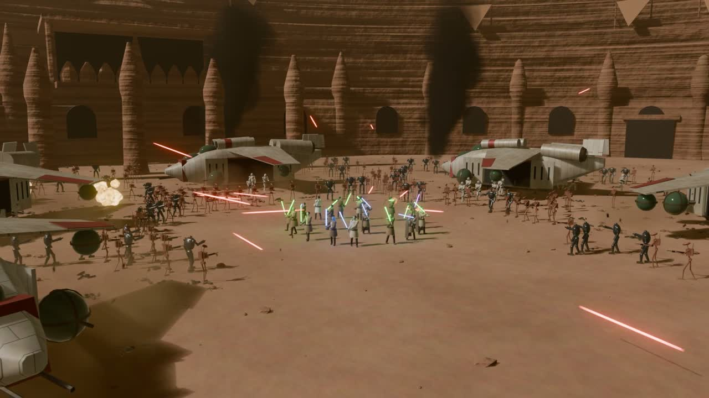
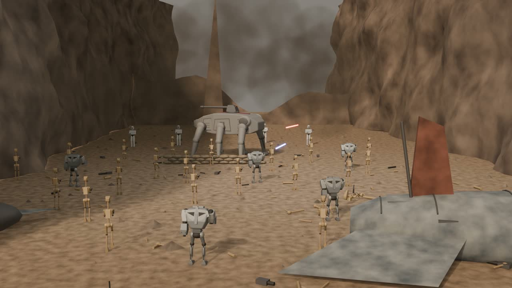
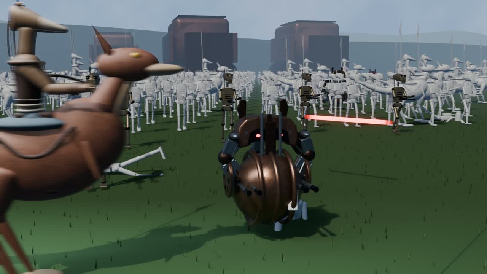
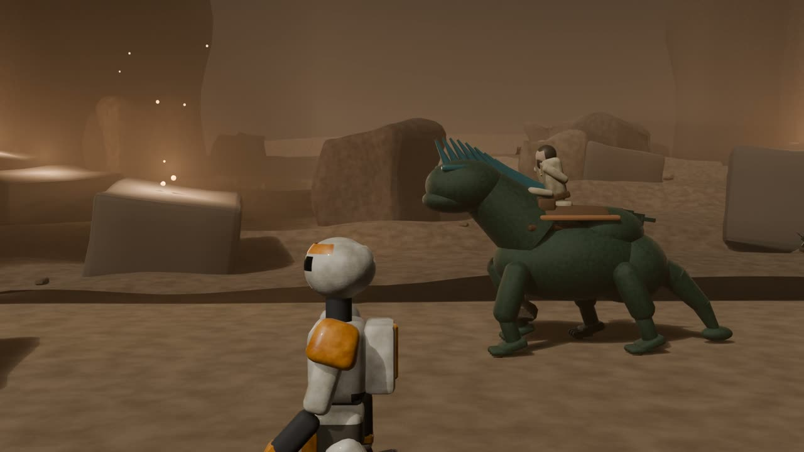
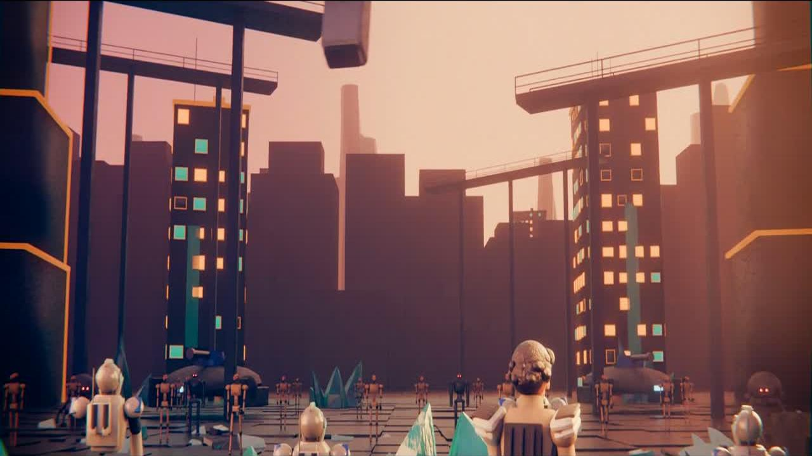
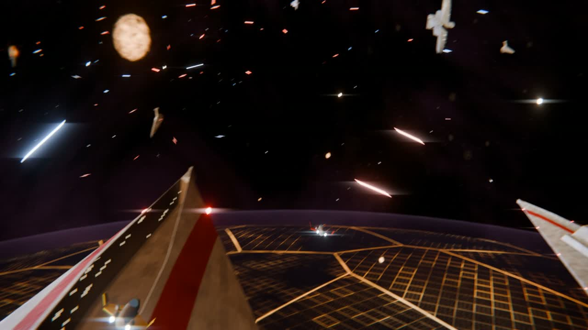
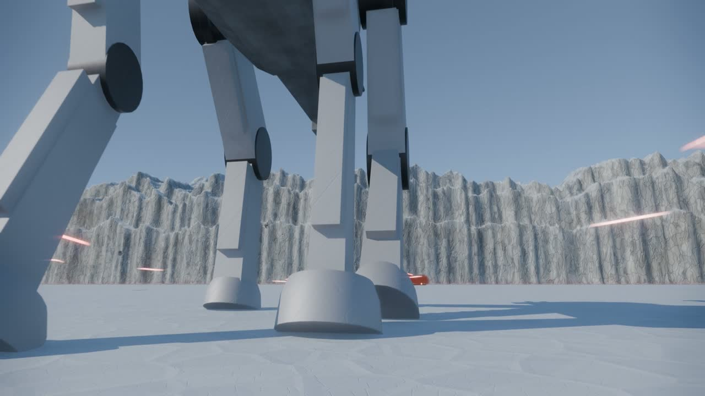
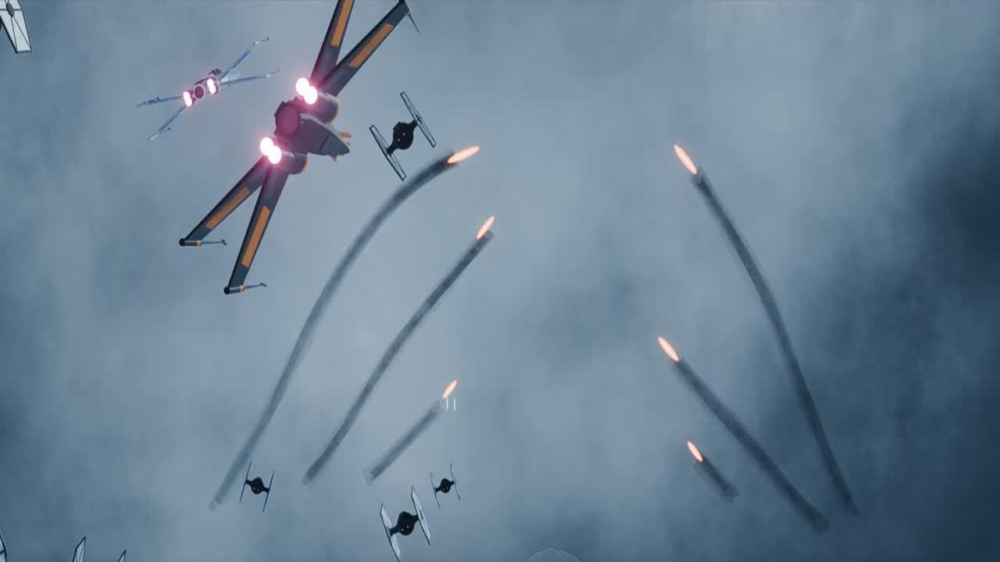

# Star Wars Blender Bench

**Which AI model rebuilds a Star Wars battle best, in Blender, from scratch, on the clock?**

🌐 **[The live bench](https://adityavg13.github.io/StarWarsBlenderBench/)** · 📺 **[YouTube channel](https://www.youtube.com/@adityavgcode)**

One model per battle. Built procedurally in Blender, no downloaded assets, timed, first attempt. Film footage used as reference only. The question isn't which model makes the prettiest picture. It's which one can rebuild a battle.

## Results

| # | Battle | Film | Model | Build time | Attempt | Video |
|---|--------|------|-------|------------|---------|-------|
| 1 | First Battle of Geonosis | Attack of the Clones (2002) | Fable 5.2 xHigh | 1.5 hours | 1 | [▶ watch](https://youtu.be/4W1jZB049jw) |
| 2 | Battle of Ryloth | The Clone Wars (2008) | GPT 6.1 Terra xHigh | 1 hr 20 min | 1 | [▶ watch](https://youtu.be/tq_osUJ2X1M) |
| 3 | Battle of Naboo | The Phantom Menace (1999) | Kimi K3.1 Max | 1 hour | 1 | [▶ watch](https://youtu.be/lHrlM-nDsoE) |
| 4 | Battle of Utapau | Revenge of the Sith (2005) | MiniMax M3.1-Flash | 1.5 hours | 1 | [▶ watch](https://youtu.be/bV9RV8DgA9M) |
| 5 | Battle of Christophsis | The Clone Wars (2008) | DeepSeek-v4.1-Flash-1017 | 1.5 hours | 1 | [▶ watch](https://youtu.be/SzycsGpB5H4) |
| 6 | Battle of Coruscant | Revenge of the Sith (2005) | Opus 5.5 | 20 min | 1 | [▶ watch](https://youtu.be/2Qfdrq6uEMA) |
| 7 | Battle of Crait | The Last Jedi (2017) | Opus 5.5 | 40 min | 1 | [▶ watch](https://youtu.be/ZBhaDbmMUYU) |
| 8 | Battle of Starkiller Base | The Force Awakens (2015) | Gemini 4 Carbon High | 9 hrs 47 min | 1 | [▶ watch](https://youtu.be/s2xnSy8mUdE) |

## Reconstructions

<table>
  <tr>
    <td align="center" width="50%">
       
      <b>First Battle of Geonosis</b> 
      Fable 5.2 xHigh · 1.5 hrs · <a href="https://youtu.be/4W1jZB049jw">▶ watch</a>
    </td>
    <td align="center" width="50%">
       
      <b>Battle of Ryloth</b> 
      GPT 6.1 Terra xHigh · 1 hr 20 min · <a href="https://youtu.be/tq_osUJ2X1M">▶ watch</a>
    </td>
  </tr>
  <tr>
    <td align="center" width="50%">
       
      <b>Battle of Naboo</b> 
      Kimi K3.1 Max · 1 hr · <a href="https://youtu.be/lHrlM-nDsoE">▶ watch</a>
    </td>
    <td align="center" width="50%">
       
      <b>Battle of Utapau</b> 
      MiniMax M3.1-Flash · 1.5 hrs · <a href="https://youtu.be/bV9RV8DgA9M">▶ watch</a>
    </td>
  </tr>
  <tr>
    <td align="center" width="50%">
       
      <b>Battle of Christophsis</b> 
      DeepSeek-v4.1-Flash-1017 · 1.5 hrs · <a href="https://youtu.be/SzycsGpB5H4">▶ watch</a>
    </td>
    <td align="center" width="50%">
       
      <b>Battle of Coruscant</b> 
      Opus 5.5 · 20 min · <a href="https://youtu.be/2Qfdrq6uEMA">▶ watch</a>
    </td>
  </tr>
  <tr>
    <td align="center" width="50%">
       
      <b>Battle of Crait</b> 
      Opus 5.5 · 40 min · <a href="https://youtu.be/ZBhaDbmMUYU">▶ watch</a>
    </td>
    <td align="center" width="50%">
       
      <b>Battle of Starkiller Base</b> 
      Gemini 4 Carbon High · 9 hrs 47 min · <a href="https://youtu.be/s2xnSy8mUdE">▶ watch</a>
    </td>
  </tr>
</table>

## The rules

- **Timed.** The clock runs from a blank `.blend` to final render. Nothing before counts, nothing after counts.
- **First attempt.** One run per model per battle. What you watch is what came out, not the tenth take.
- **Built in Blender.** Every mesh is built in Blender. Film footage is reference, never compositing material.
- **Still running.** New models get tested as they land, including rematches on past battles, and old ones can re-run. Every bout lists its model and test date, so the card stays comparable.

## Honest limitations

- Judged by eyeball against the film: silhouette, layout, motion, mood. No automated scoring yet.
- One run per model per battle, so times and quality are single samples, not averages.
- Build times are wall-clock for that run, on that day's tooling. Compare loosely, not to the minute.

---

Fan art. Not affiliated with Lucasfilm or Disney. Stills on the [live page](https://adityavg13.github.io/StarWarsBlenderBench/) are frames of these reconstructions.
